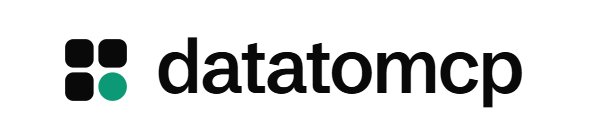

<p align="center">
  <picture>
    <source media="(prefers-color-scheme: dark)" srcset="assets/datatomcp-lockup-dark.png">
    
  </picture>
</p>

<p align="center"><b>Turn a CSV or Google Sheet into a remote MCP server your AI agents can query.</b></p>

<p align="center">
  <a href="https://datatomcp.com">Website</a> ·
  <a href="https://app.datatomcp.com/login">Start free</a> ·
  <a href="https://datatomcp.com/guides">Guides</a> ·
  <a href="https://www.youtube.com/watch?v=6z4l6sLqcyE">Demo video</a>
</p>

<p align="center">
  <a href="https://mcpservers.org/servers/datatomcp/datatomcp-mcp"></a>
</p>

---

datatomcp is a hosted MCP server for your tabular data. Upload a CSV, paste a CSV link, or pick a Google Sheet. Your agent (Claude, ChatGPT, Cursor and others) can then filter, group and total the rows. The numbers are computed by a database, not estimated by the model.

- **Hosted.** Nothing to install or run. One URL works in every client that supports remote MCP servers.
- **OAuth sign-in.** No API key to paste into your agent. You can revoke access at any time.
- **Exact results.** Counts, sums and averages come from DuckDB. Every result says which version of the dataset it came from.
- **Private Google Sheets.** You pick the sheet in Google's file picker, and datatomcp can read that file only. Pro syncs it every hour.
- **Import report.** Bad lines, numbers stored as text and mixed date formats are reported before any agent sees the data.
- **Read-only.** Agents can query your data, but they can't change it or run raw SQL.
- **Hosted in the EU.** Your data is never sent to AI providers or used for training.

This repository holds the public documentation and client configuration. The service itself runs at `app.datatomcp.com`.

## Server

| | |
|---|---|
| URL | `https://app.datatomcp.com/mcp` |
| Transport | Streamable HTTP |
| Auth | OAuth 2.1 (dynamic client registration and client ID metadata documents) |
| Registry name | `com.datatomcp/datatomcp` |

## Quick start

1. Sign up at [app.datatomcp.com](https://app.datatomcp.com/login) (free, no card).
2. Add a dataset: upload a CSV, paste a link, or choose a Google Sheet.
3. Add the server to your client (below), sign in when asked, and ask a question about your data.

## Tools

| Tool | What it does |
|---|---|
| `list_datasets` | Your datasets, with row counts and freshness |
| `describe_dataset` | Columns, types, example values, data warnings and today's date |
| `query_rows` | Filter, sort, select columns and paginate (up to 1,000 rows per call) |
| `aggregate` | Group by columns; count, distinct count, sum, average, min and max |
| `distinct_values` | The real values in a column, so filters match exactly |

Filters support `eq`, `neq`, `gt`, `gte`, `lt`, `lte`, `in`, `not_in`, `contains`, `starts_with`, `between`, `is_null` and `not_null`.

## Client setup

### Claude (Claude.ai and Claude Desktop)

Settings → Connectors → **Add custom connector**. Paste `https://app.datatomcp.com/mcp`, name it `datatomcp`, connect, and allow access.

### Claude Code

```bash
claude mcp add --transport http datatomcp https://app.datatomcp.com/mcp
```

Then run `/mcp`, choose **datatomcp** and sign in.

### ChatGPT

Settings → Apps & Connectors → Advanced, and turn on developer mode. Create a connector with the URL above and OAuth authentication, then sign in.

### Cursor

Settings → MCP → **Add new server**. Choose type HTTP and use the URL above. Cursor asks you to log in the first time.

### VS Code

`.vscode/mcp.json`:

```json
{
  "servers": {
    "datatomcp": { "type": "http", "url": "https://app.datatomcp.com/mcp" }
  }
}
```

### Windsurf

`~/.codeium/windsurf/mcp_config.json`:

```json
{
  "mcpServers": {
    "datatomcp": { "serverUrl": "https://app.datatomcp.com/mcp" }
  }
}
```

### Cline

Open the MCP Servers panel → **Remote Servers**, name it `datatomcp`, and use the URL above. Or add it to `cline_mcp_settings.json`:

```json
{
  "mcpServers": {
    "datatomcp": { "type": "streamableHttp", "url": "https://app.datatomcp.com/mcp" }
  }
}
```

### Antigravity

Customizations → MCP servers → View raw config (`mcp_config.json`):

```json
{
  "mcpServers": {
    "datatomcp": { "serverUrl": "https://app.datatomcp.com/mcp" }
  }
}
```

Click Refresh, then Authenticate.

### OpenCode

`opencode.json`:

```json
{
  "$schema": "https://opencode.ai/config.json",
  "mcp": {
    "datatomcp": { "type": "remote", "url": "https://app.datatomcp.com/mcp" }
  }
}
```

### Codex

```bash
codex mcp add datatomcp --url https://app.datatomcp.com/mcp
codex mcp login datatomcp
```

### Gemini CLI

```bash
gemini mcp add --transport http datatomcp https://app.datatomcp.com/mcp
```

Then run `/mcp auth datatomcp`.

### Clients with local (stdio) servers only

Use [`mcp-remote`](https://www.npmjs.com/package/mcp-remote) as a bridge. It handles the sign-in:

```json
{
  "mcpServers": {
    "datatomcp": { "command": "npx", "args": ["-y", "mcp-remote", "https://app.datatomcp.com/mcp"] }
  }
}
```

## Example

> How many orders came from France in September, and what was the revenue?

The agent calls `describe_dataset` to learn the columns, then one `aggregate` call:

```json
{
  "dataset_id": "ds_orders",
  "where": [
    { "column": "country", "op": "eq", "value": "France" },
    { "column": "order_date", "op": "between", "value": ["2026-09-01", "2026-09-30"] }
  ],
  "metrics": [
    { "fn": "count", "as": "orders" },
    { "fn": "sum", "column": "total", "as": "revenue" }
  ]
}
```

On our 50,000-row test sheet, it answers with 277 orders and €50,279.50 in revenue. The tool result is 32 bytes, not the whole sheet.

## REST API

The same datasets are also available over REST with an API key, for apps and automations such as n8n or Make. See [CSV to REST API](https://datatomcp.com/guides/csv-to-rest-api).

## Plans

| | Free | Pro ($12 or €12 a month) |
|---|---|---|
| Datasets | 3 | 25 |
| Rows per dataset | 100,000 | 2,000,000 |
| Queries per day | 1,000 | 50,000 |
| Google Sheets sync | On demand | Hourly |

## Guides

- [Connect Google Sheets to Claude](https://datatomcp.com/guides/connect-google-sheets-to-claude)
- [Google Sheets MCP server](https://datatomcp.com/guides/google-sheets-mcp-server)
- [CSV MCP server](https://datatomcp.com/guides/csv-mcp-server)
- [Analyze large CSVs with AI](https://datatomcp.com/guides/analyze-large-csv-with-ai)

## Support

Questions, bugs or a file that doesn't import the way you expect: [hello@datatomcp.com](mailto:hello@datatomcp.com), or open an issue in this repository.

## License

The documentation and configuration in this repository are MIT licensed. The datatomcp service is proprietary.
