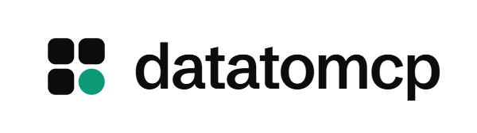

<p align="center">
  <picture>
    <source media="(prefers-color-scheme: dark)" srcset="assets/datatomcp-lockup-dark.png">
    
  </picture>
</p>

<p align="center"><b>The AI-native data layer for teams without a data team. Your team's data, ready for every AI agent.</b></p>

<p align="center">
  <a href="https://datatomcp.com">Website</a> ·
  <a href="https://app.datatomcp.com/login">Start free</a> ·
  <a href="https://datatomcp.com/guides">Guides</a> ·
  <a href="https://www.youtube.com/watch?v=Wtt4ZplrE4I">Demo video</a>
</p>

<p align="center">
  <a href="https://mcpservers.org/servers/datatomcp/datatomcp-mcp"></a>
</p>

---

datatomcp is one governed place for a team's data, that every AI agent can ask: Google Sheets, CSV and Excel files, PostgreSQL and MySQL, Stripe, HubSpot and Airtable. Connect your data once: datatomcp links the datasets, drafts definitions of what each number means for a person to approve, and records every question an agent asks. Agents (Claude, ChatGPT, Cursor, n8n and others) query it over MCP or REST, and a database computes the answer, so totals are exact. News: [datatomcp is now an AI-native data layer](https://datatomcp.com/news/ai-native-data-layer) (4 Nov 2026).

- **Hosted.** Nothing to install or run. One URL works in every client that supports remote MCP servers.
- **OAuth sign-in.** No API key to paste into your agent. You can revoke access at any time.
- **Exact, versioned results.** Counts, sums and averages come from DuckDB. Every result names the dataset version it came from and links to the rows behind it.
- **Shared definitions.** Approved definitions like `paid_revenue` and a glossary of your team's words. Agents use them by name, and the answer says who approved the definition.
- **Audit trail.** Every agent question is kept: who asked, from which agent, the query, the data version. Repeated questions are compared. Export as CSV.
- **Linked datasets.** Orders, customers and regions in one question, with unmatched rows counted.
- **Charts and dashboards.** The `chart` tool draws the answer in the chat (52 chart types, as an MCP Apps view). Agents make dashboards from your questions and refresh them later; dashboards never change your data.
- **Workspaces.** Owners, editors and viewers; each agent connection can be limited to some workspaces.
- **Private Google Sheets.** You pick the sheet in Google's file picker, and datatomcp can read that file only. Pro syncs within 5 minutes of an edit.
- **Import report.** Bad lines, numbers stored as text and mixed date formats are reported before any agent sees the data.
- **Read-only data.** Agents can query your data, but they can't change it or run raw SQL. The only tools that write create dashboards or send your team a note.
- **Hosted in the EU.** Your data is never used for training. AI features inside datatomcp (cleaning suggestions, an assistant on your own key) are off until you turn them on.

This repository holds the public documentation and client configuration. The service itself runs at `app.datatomcp.com`.

## Server

| | |
|---|---|
| URL | `https://app.datatomcp.com/mcp` |
| Transport | Streamable HTTP |
| Auth | OAuth 2.1 (dynamic client registration and client ID metadata documents) |
| Registry name | `com.datatomcp/datatomcp` |

## Quick start

1. Sign up at [app.datatomcp.com](https://app.datatomcp.com/login) (free, no card).
2. Add a dataset: upload a CSV or Excel file, choose a Google Sheet, or connect PostgreSQL, MySQL, Stripe, HubSpot or Airtable. New accounts start with an example dataset.
3. Add the server to your client (below), sign in when asked, and ask a question about your data.

## Tools

| Tool | What it does |
|---|---|
| `workspace_overview` | Every dataset with what its columns mean, the approved definitions, the links between datasets and example questions, in one call |
| `list_datasets` | Your datasets, with row counts and freshness |
| `describe_dataset` | Columns, types, example values, approved definitions, glossary, links to other datasets, data warnings and today's date |
| `query_rows` | Filter, sort, select columns and paginate (up to 1,000 rows per call) |
| `aggregate` | Group by columns; count, distinct count, sum, average, min and max, or a saved definition by name |
| `distinct_values` | The real values in a column, so filters match exactly |
| `chart` | Draws a query's answer as a chart in the conversation, with the takeaway as the title |
| `create_dashboard` | Makes a dashboard (a one-page board or a short story of slides) in your workspace |
| `list_dashboards` | The workspace's dashboards |
| `refresh_dashboard` | Re-runs a dashboard on the current data |
| `report_issue` | Sends your team a note about a data problem |

Filters support `eq`, `neq`, `gt`, `gte`, `lt`, `lte`, `in`, `not_in`, `contains`, `starts_with`, `between`, `is_null` and `not_null`.

## Client setup

### Claude (Claude.ai and Claude Desktop)

Settings → Connectors → **Add custom connector**. Paste `https://app.datatomcp.com/mcp`, name it `datatomcp`, connect, and allow access.

### Claude Code

```bash
claude mcp add --transport http datatomcp https://app.datatomcp.com/mcp
```

Then run `/mcp`, choose **datatomcp** and sign in.

### ChatGPT

Settings → Apps & Connectors → Advanced, and turn on developer mode. Create a connector with the URL above and OAuth authentication, then sign in.

### Cursor

Settings → MCP → **Add new server**. Choose type HTTP and use the URL above. Cursor asks you to log in the first time.

### VS Code

`.vscode/mcp.json`:

```json
{
  "servers": {
    "datatomcp": { "type": "http", "url": "https://app.datatomcp.com/mcp" }
  }
}
```

### Windsurf

`~/.codeium/windsurf/mcp_config.json`:

```json
{
  "mcpServers": {
    "datatomcp": { "serverUrl": "https://app.datatomcp.com/mcp" }
  }
}
```

### Cline

Open the MCP Servers panel → **Remote Servers**, name it `datatomcp`, and use the URL above. Or add it to `cline_mcp_settings.json`:

```json
{
  "mcpServers": {
    "datatomcp": { "type": "streamableHttp", "url": "https://app.datatomcp.com/mcp" }
  }
}
```

### Antigravity

Customizations → MCP servers → View raw config (`mcp_config.json`):

```json
{
  "mcpServers": {
    "datatomcp": { "serverUrl": "https://app.datatomcp.com/mcp" }
  }
}
```

Click Refresh, then Authenticate.

### OpenCode

`opencode.json`:

```json
{
  "$schema": "https://opencode.ai/config.json",
  "mcp": {
    "datatomcp": { "type": "remote", "url": "https://app.datatomcp.com/mcp" }
  }
}
```

### Codex

```bash
codex mcp add datatomcp --url https://app.datatomcp.com/mcp
codex mcp login datatomcp
```

### Gemini CLI

```bash
gemini mcp add --transport http datatomcp https://app.datatomcp.com/mcp
```

Then run `/mcp auth datatomcp`.

### Clients with local (stdio) servers only

Use [`mcp-remote`](https://www.npmjs.com/package/mcp-remote) as a bridge. It handles the sign-in:

```json
{
  "mcpServers": {
    "datatomcp": { "command": "npx", "args": ["-y", "mcp-remote", "https://app.datatomcp.com/mcp"] }
  }
}
```

## Example

> How many orders came from France in September, and what was the revenue?

The agent calls `describe_dataset` to learn the columns, then one `aggregate` call:

```json
{
  "dataset_id": "ds_orders",
  "where": [
    { "column": "country", "op": "eq", "value": "France" },
    { "column": "order_date", "op": "between", "value": ["2026-09-01", "2026-09-30"] }
  ],
  "metrics": [
    { "fn": "count", "as": "orders" },
    { "fn": "sum", "column": "total", "as": "revenue" }
  ]
}
```

On our 50,000-row test sheet, it answers with 277 orders and €50,279.50 in revenue. The tool result is 32 bytes, not the whole sheet.

## REST API

The same datasets, definitions and query engine are available over REST with an API key, for apps and automations such as n8n, Make or Zapier. Reference: [datatomcp.com/docs/api](https://datatomcp.com/docs/api). OpenAPI 3.1: [datatomcp.com/openapi.json](https://datatomcp.com/openapi.json).

## Plans

| | Free | Pro ($12 or €12 a month) |
|---|---|---|
| Datasets | 3 | 25 |
| Rows per dataset | 100,000 | 2,000,000 |
| Queries per day | 1,000 | 50,000 |
| Workspaces | 1, 2 people | 3, 5 people each |
| Audit history | 30 days | 90 days |
| Google Sheets sync | On demand | Within 5 minutes |

## Guides

- [Connect Google Sheets to Claude](https://datatomcp.com/guides/connect-google-sheets-to-claude)
- [Google Sheets MCP server](https://datatomcp.com/guides/google-sheets-mcp-server)
- [CSV MCP server](https://datatomcp.com/guides/csv-mcp-server)
- [Analyze large CSVs with AI](https://datatomcp.com/guides/analyze-large-csv-with-ai)
- [Shared definitions for AI agents](https://datatomcp.com/guides/shared-definitions-ai-agents)
- [Audit what your AI agents asked](https://datatomcp.com/guides/audit-ai-agent-questions)

## Support

Questions, bugs or a file that doesn't import the way you expect: [hello@datatomcp.com](mailto:hello@datatomcp.com), or open an issue in this repository.

## License

The documentation and configuration in this repository are MIT licensed. The datatomcp service is proprietary.
